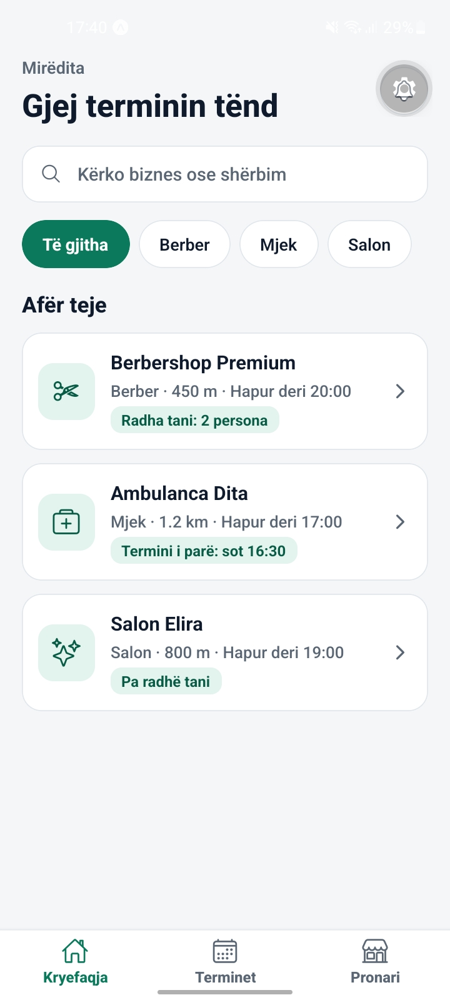
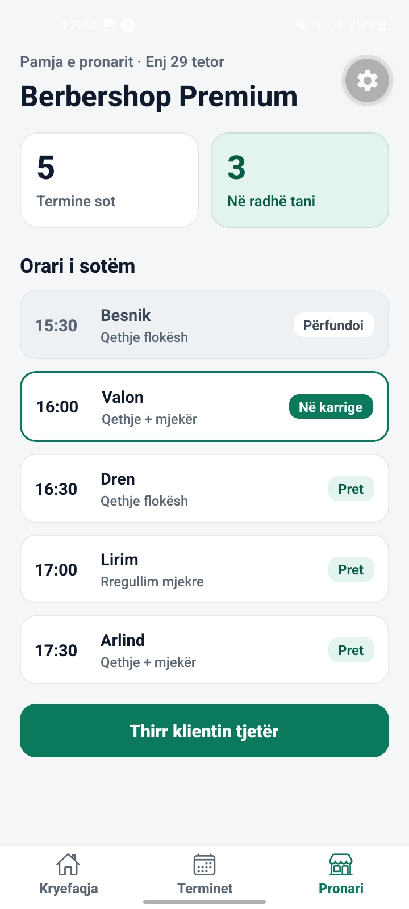

# 📅 Rezervo Online

### 📲 Rezervo termin. Shmang pritjen. Menaxho kohën më mirë.

**Rezervo Online** është një aplikacion mobil për rezervimin e termineve dhe menaxhimin e radhëve virtuale te bizneset e vogla, si berberët, mjekët privatë dhe sallonet e bukurisë.

Klientët mund të gjejnë biznese, të zgjedhin shërbimin, ditën dhe orën e dëshiruar, si dhe të shohin statusin e rezervimit dhe radhën e tyre. Ndërsa pronarët mund t'i menaxhojnë terminet e ditës nga një ekran i vetëm.

🎯 **Qëllimi i projektit:** Zhvillimi i një aplikacioni Android me potencial për publikim në Google Play Store.

---

## 💡 Problemi që zgjidhim

Shumë biznese të vogla ende i menaxhojnë terminet përmes fletoreve ose telefonatave. Si rezultat, klientët shpesh presin në lokal pa e ditur se sa do të zgjasë pritja.

**Rezervo Online** synon ta bëjë këtë proces më të thjeshtë dhe më efikas duke mundësuar:

- 📱 Rezervimin e termineve direkt nga telefoni.
- ⏳ Informimin për numrin e personave para klientit.
- 🔔 Kujtesa për terminet e rezervuara, si funksion i planifikuar.
- 🗓️ Organizimin dhe menaxhimin më të lehtë të termineve për pronarët.

## ✨ Funksionalitetet aktuale

Projekti është aktualisht një **prototip funksional me të dhëna shembull**, pa server ose bazë të dhënash të lidhur.

### 🏠 1. Kryefaqja

- Lista e bizneseve.
- 🔍 Kërkimi sipas emrit të biznesit.
- 🏷️ Filtrimi sipas kategorisë: Berber, Mjek dhe Salon.

### 📆 2. Rezervimi i terminit

- Zgjedhja e shërbimit.
- Përzgjedhja e ditës dhe orës.
- 🚫 Orët e zëna nuk mund të zgjidhen.

### 🎫 3. Termini im

- Konfirmimi i rezervimit.
- 🔢 Numri i personave para klientit.
- ⏱️ Koha e parashikuar e pritjes.
- ❌ Anulimi i terminit me konfirmim.

### 💼 4. Paneli i pronarit

- 📋 Shfaqja e termineve të ditës.
- 🔄 Menaxhimi i statuseve: **Pret, Në karrige, Përfundoi**.
- 📣 Butoni “Thirr klientin tjetër”.

## 🚧 Funksionalitetet që planifikohen

Disa funksione ende nuk janë implementuar dhe do të zhvillohen në fazat e ardhshme:

- 🗄️ Integrimi me një server dhe bazë të dhënash.
- 🔐 Krijimi i llogarive dhe hyrja për klientët e pronarët.
- ⚡ Përditësimi në kohë reale i radhës virtuale.
- 🔔 Njoftimet push dhe kujtesat automatike.
- 💳 Pagesat online.
- ⭐ Vlerësimet dhe komentet për bizneset.
- 📍 Harta dhe lokacionet e bizneseve.

## 🛠️ Teknologjitë e përdorura

| Teknologjia | Përdorimi |
|---|---|
| ⚛️ React Native | Zhvillimi i aplikacionit mobil |
| 🚀 Expo SDK 58 | Zhvillimi dhe testimi i aplikacionit |
| 📘 TypeScript | Shkrimi i kodit me tipe të përcaktuara |
| 🧭 Expo Router | Navigimi ndërmjet ekraneve |
| 🔄 React Context | Menaxhimi i gjendjes së përbashkët të rezervimeve |
| 🎨 `@expo/vector-icons` | Ikonat e ndërfaqes |

## 🚀 Si ta instalosh dhe ta ekzekutosh

### Kërkesat paraprake

- [Node.js](https://nodejs.org/) — rekomandohet versioni LTS.
- [Expo Go](https://expo.dev/go) — për testimin e aplikacionit në telefon.
- Git — për klonimin e projektit.
- Një kompjuter dhe telefon me lidhje interneti.

### Hapat e instalimit

**1. Klonoje projektin**

```bash
git clone <linku-i-repozitorit>
```

**2. Hyr në dosjen e projektit**

```bash
cd <emri-i-dosjes>
```

**3. Instalo varësitë**

```bash
npm install
```

**4. Nise aplikacionin**

```bash
npx expo start
```

**5. Hape në telefon 📲**

Skano kodin QR me Expo Go në Android. Nëse lidhja lokale nuk funksionon, provo:

```bash
npx expo start --tunnel
```

> ℹ️ Sigurohu që versioni i Expo Go të jetë i përputhshëm me versionin e Expo SDK që përdor projekti.

## 📂 Struktura e projektit

```text
app/
├── _layout.tsx
├── (tabs)/
│   ├── _layout.tsx
│   ├── index.tsx
│   ├── terminet.tsx
│   └── pronari.tsx
└── biznes/
    └── [id].tsx

components/
└── BiznesKarte.tsx

constants/
└── ngjyrat.ts

context/
└── TerminiContext.tsx

data/
└── bizneset.ts

utils/
└── data.ts
```

📌 **Përshkrimi i dosjeve kryesore:**

- `app/` — ekranet dhe navigimi i aplikacionit.
- `components/` — komponentët e ripërdorshëm të ndërfaqes.
- `constants/` — ngjyrat dhe konfigurimet e përbashkëta.
- `context/` — gjendja e përbashkët e rezervimeve.
- `data/` — të dhënat shembull të bizneseve.
- `utils/` — funksionet ndihmëse për datat dhe oraret.

## 📑 Dokumentet e projektit

Dokumentet e mëposhtme përmbajnë informacione shtesë rreth projektit:

- 👥 [EKIPI.md](EKIPI.md) — anëtarët e ekipit dhe përdoruesi i parë.
- 💬 [BISEDAT.md](BISEDAT.md) — bisedat me persona që përballen me problemin.
- 🗺️ [HARTA.md](HARTA.md) — rrjedha e aplikacionit dhe kufijtë e versionit fillestar (MVP).
- 🎤 [PITCH.md](PITCH.md) — prezantimi njëminutësh i projektit.

## 🛣️ Plani i zhvillimit

| Faza | Përshkrimi |
|---|---|
| ✅ 1 | Krijimi i prototipit me të dhëna shembull |
| 🔜 2 | Integrimi me Supabase ose Firebase |
| 🔜 3 | Krijimi i llogarive për klientët dhe pronarët |
| 🔜 4 | Implementimi i radhës në kohë reale dhe njoftimeve |
| 🔜 5 | Testimi me të paktën dy biznese reale |
| 🎯 6 | Përgatitja dhe publikimi në Google Play Store |

## 📸 Pamje nga aplikacioni

Pamjet e ekranit do të shtohen këtu për të paraqitur ndërfaqen dhe funksionalitetet e aplikacionit.


### 🏠 1. Kryefaqja
Pamja kryesore ku përdoruesit mund të kërkojnë biznese dhe të zgjedhin kategorinë e dëshiruar.



### 📅 2. Terminet
Pamja ku përdoruesit mund të shohin terminet dhe rezervimet e tyre.



### 💼 3. Paneli i pronarit
Pamja ku pronari mund të menaxhojë terminet dhe statusin e klientëve.


---


## 👥 Ekipi i projektit

- **Anëtar-ja:** [Agnesa Hoti](https://github.com/agnesahoti/projekti-im)


## 🎓 Informacion rreth projektit

- **Lënda:** Zhvillimi i Aplikacioneve Mobile
- **Lloji:** Aplikacion mobil Android
- **Emri i projektit:** Rezervo Online
- **Statusi:** Prototip funksional në zhvillim

---

⭐ **Rezervo Online — më pak pritje, më shumë kohë për gjërat që kanë rëndësi!**
